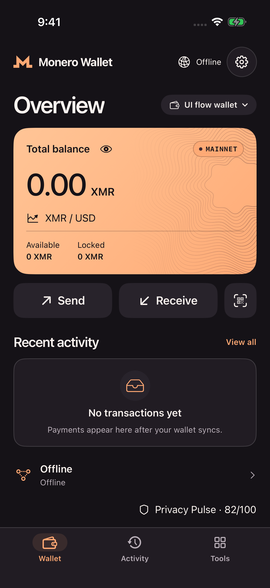
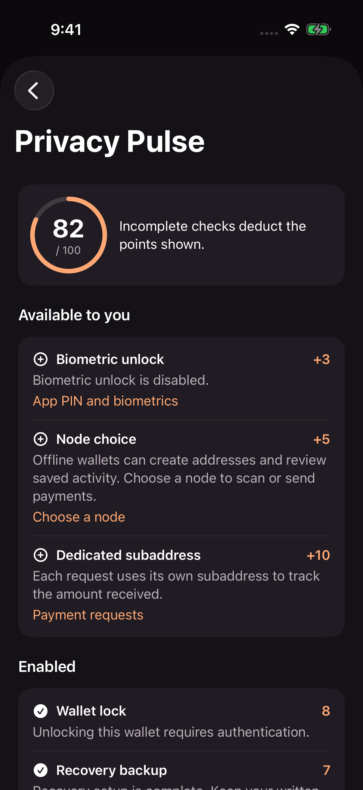

# XMR Monero Wallet - Safe and opensource

A free, independent, self-custody Monero wallet for iPhone. Read the app code, inspect the wallet engine and build your own copy. The app charges no subscription, purchase price or service fee. Sending XMR incurs a Monero network fee, shown before confirmation.

**Version 0.3.0 · iPhone developer preview.** This app has not had an independent security audit. Evaluate it with disposable wallets. It has no App Store or TestFlight release.

<p>
  
  
  
</p>

## Wallet features

| Area | Implementation |
| --- | --- |
| Wallets and recovery | Create a 25-word wallet, keep multiple wallets, restore by classic seed, Polyseed, supported MyMonero or BIP39 derivations, spend and view keys, or a view key alone. [Recovery formats](Recovery/README.md) |
| Receive | Choose a labeled address, add an optional exact amount to its QR, or create a dedicated invoice and follow its receipts. |
| Send | Paste an address or scan a payment URI with the camera or photo picker. Request the maximum after fees, use one funded subaddress or select outputs. Review the exact amount and fee, swipe and authenticate. Add a private transaction note. |
| Activity and coins | Search local notes, hashes, addresses and contacts, filter sent or received activity, and see totals and confirmations by date. Label, freeze or select outputs. |
| Sync and privacy | Test the named nodes, pin a node, enable automatic failover, connect to your daemon or choose Tor or offline mode. Follow the block heights, rescan, and review Privacy Pulse’s weighted checks. |
| Air-gapped wallets | Pair a view-only wallet with an offline signer, exchange outputs and key images, review unsigned transactions, and transfer signed transactions over multipart QR. Physical two-device camera testing is pending. |
| Price chart | Follow XMR/USD with 1-day, 7-day, 30-day and 90-day charts. Enable CoinGecko for a session to see the USD balance, 24-hour change and transaction estimates. Direct price requests are available only with a direct online route. |
| Device security | Use a 6–12 digit app PIN and optional Face ID or Touch ID. Reveal encrypted recovery material after fresh authentication. Erase a wallet individually or type DELETE to clear all app data. |

Choose light, dark or system appearance. The app ships 23 interface languages. The source includes all translations and their review status. BIP39 supports the Exodus / Cake account-zero derivation. The feature comparison identifies each published reference feature, where to access it and how it was verified. [Feature comparison](Docs/FeatureCoverage.md) · [Translation coverage](Localization/README.md) · [Security and network behavior](SECURITY.md)

## Build and run

Use an Apple silicon Mac with Xcode, an iOS 17 or later arm64 simulator, or a developer-enabled iPhone. The generated Xcode project is included.

```sh
git clone https://github.com/harvard1932/xmr-monero-wallet.git
cd xmr-monero-wallet
./Scripts/prepare-core.sh
./Scripts/prepare-tor.sh
open XMRMoneroWallet.xcodeproj
```

Select the **XMRMoneroWallet** scheme and an iPhone simulator, then Run. For on-device signing, select your development team and use available matching app and extension bundle identifiers. Wallet creation on an iPhone requires a device passcode.

The default device build verifies Cake Wallet’s distribution signature and pinned engine digest. The simulator compiles wallet2 from its pinned source. You can also compile wallet2 for the physical iPhone target. [Build the engine from source](Scripts/AppleCore/README.md)

Both preparation scripts check pinned digests. The app’s Swift, native bridges, Polyseed sources, translation catalogs and dependency build instructions are public. [Wallet engine](ThirdParty/WalletEngine.md) · [Embedded Tor](ThirdParty/Tor/README.md) · [Polyseed](ThirdParty/Polyseed-NOTICE)

## Inspect and test

| Code | What to review |
| --- | --- |
| [Core](Core/) | Wallet2 operations, address and key validation, payment review and commit, output handling and offline signing. |
| [Security](Security/) | Onboarding, backup checks, iOS authentication, protected storage and erasure. |
| [App](App/) | Wallet sessions, encrypted invoice metadata, settings, node selection and certificate-validating transport. |
| [Interface](Interface/) | Amount parsing, QR operations, fee confirmation, balances, contacts and activity. |
| [Recovery](Recovery/) | Readable legacy recovery adapter, npm lockfile, public address vectors and bundle rebuild. |
| [Tests](Tests/) | XCTest coverage of amount parsing, wallet state, routing, recovery and native wallet lifecycle. |

After preparing both dependencies, choose **Product → Test** in Xcode. Opt into HTTPS, Tor and price-chart tests with `XMR_LIVE_NODE_TEST=1`, `XMR_LIVE_TOR=1` and `XMR_LIVE_MARKET=1` in the test environment. A separate [isolated-chain harness](Docs/Regtest.md) verifies offline signing, broadcast and receipt. [Verification results](Docs/Verification.md)

## License

The application code is available under the [MIT License](LICENSE). The dynamically linked monero_c wrapper uses LGPLv3, Monero wallet2 uses the BSD 3-Clause license, and bundled recovery packages retain their respective notices. [Third-party notices](ThirdParty/)

This project is independent of the Monero Project and the developer of the reference iPhone app.
