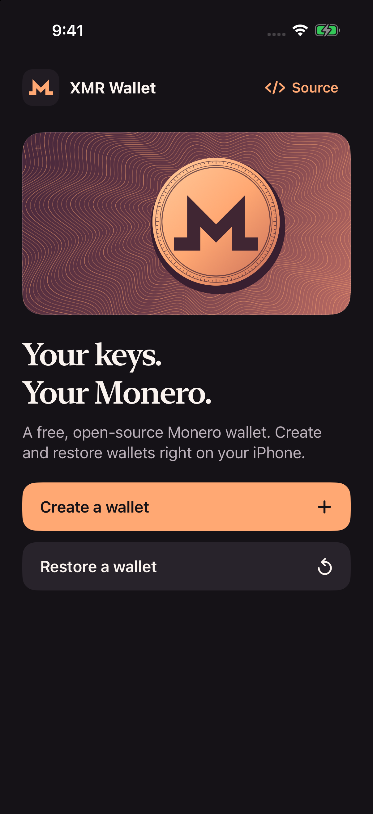
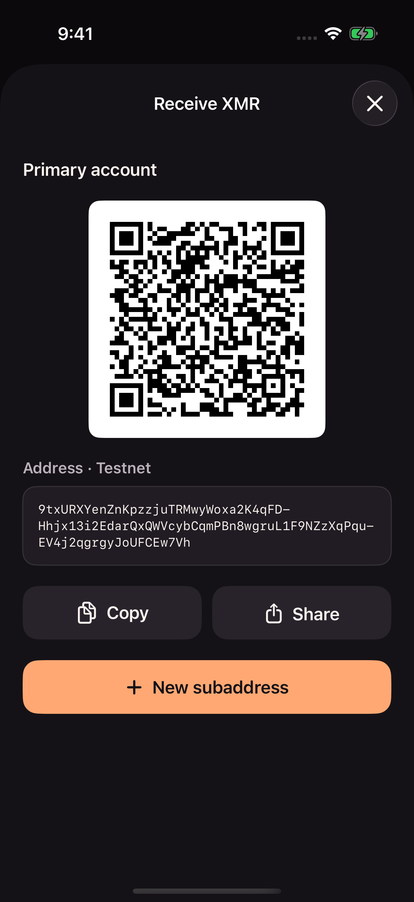

# XMR Monero Wallet - Safe and opensource

A free, independent, self-custody Monero wallet for iPhone. Read the app code, inspect the wallet engine and build your own copy. The app charges no subscription, purchase price or service fee. Sending XMR incurs a Monero network fee, shown before confirmation.

**Developer preview.** This app has not had an independent security audit. Evaluate it with disposable wallets. It has no App Store or TestFlight release.

<p>
  
  
  
</p>

## Wallet features

| Area | Implementation |
| --- | --- |
| Wallets and recovery | Create a 25-word wallet, keep multiple wallets, restore by classic seed, Polyseed, supported MyMonero or BIP39 derivations, spend and view keys, or a view key alone. [Recovery formats](Recovery/README.md) |
| Receive | Display a primary address or a new labeled subaddress, show or share payment QR codes, and track a requested amount on a dedicated invoice address. |
| Send | Paste or scan a Monero address or payment URI, choose a fee priority, inspect the exact amount and network fee, then confirm the prepared transaction. Amounts use integer atomic units. |
| Activity and coins | See available and locked balances, incoming and outgoing payments, confirmations and individual outputs. Label, freeze or select outputs and maintain a local address book. |
| Sync and privacy | Start offline. Choose public-node selection or a custom daemon, optionally through a local Tor proxy. Follow scan progress, keep the screen awake or enable a sync Live Activity. |
| Air-gapped wallets | Pair a view-only wallet with an offline signer, exchange outputs and key images, review unsigned transactions, and transfer signed transactions over multipart QR. Physical two-device camera testing is pending. |
| Price chart | Load an optional XMR/USD chart from Kraken. The chart stays disabled while offline or using proxy routing. |
| Device security | Device passcode or biometric unlock, protected Keychain credentials, written-backup confirmation, switcher privacy cover, per-wallet deletion and full data removal. |

The language picker offers English and 21 additional languages. Navigation, onboarding and common wallet actions are partially translated. Untranslated messages fall back to English. [Translation coverage](Localization/README.md) Tor routing uses a separately running local proxy. BIP39 interoperability depends on the originating wallet's derivation path. [Security and network behavior](SECURITY.md)

## Build and run

Use an Apple silicon Mac with Xcode, an iOS 17 or later arm64 simulator, or a developer-enabled iPhone. The generated Xcode project is included.

```sh
git clone https://github.com/harvard1932/xmr-monero-wallet.git
cd xmr-monero-wallet
./Scripts/prepare-core.sh
open XMRMoneroWallet.xcodeproj
```

Select the **XMRMoneroWallet** scheme and an iPhone simulator, then Run. For on-device signing, select your development team and use available matching app and extension bundle identifiers. Wallet creation on an iPhone requires a device passcode.

The preparation script verifies the native release archive's SHA-256 digest before extracting the device and simulator libraries. The repository includes the bridge, header files and packaging script. [Engine source, exact revision, archive digest and rebuild instructions](ThirdParty/WalletEngine.md)

## Inspect and test

| Code | What to review |
| --- | --- |
| [Core](Core/) | Wallet2 operations, address and key validation, payment review and commit, output handling and offline signing. |
| [Security](Security/) | Onboarding, backup checks, iOS authentication, protected storage and erasure. |
| [App](App/) | Wallet sessions, encrypted invoice metadata, settings, node selection and certificate-validating transport. |
| [Interface](Interface/) | Amount parsing, QR operations, fee confirmation, balances, contacts and activity. |
| [Recovery](Recovery/) | Readable legacy recovery adapter, npm lockfile, public address vectors and bundle rebuild. |
| [Tests](Tests/) | XCTest coverage of amount parsing, wallet state, routing, recovery and native wallet lifecycle. |

After preparing the engine, choose **Product → Test** in Xcode. The public HTTPS test requires opting in with the test environment variable `XMR_LIVE_NODE_TEST=1`. The remaining tests run without a public node. A separate [isolated-chain harness](Docs/Regtest.md) verifies offline signing, broadcast and receipt. [Verification results](Docs/Verification.md)

## License

The application code is available under the [MIT License](LICENSE). The dynamically linked monero_c wrapper uses LGPLv3, Monero wallet2 uses the BSD 3-Clause license, and bundled recovery packages retain their respective notices. [Third-party notices](ThirdParty/)

This project is independent of the Monero Project and the developer of the reference iPhone app.
